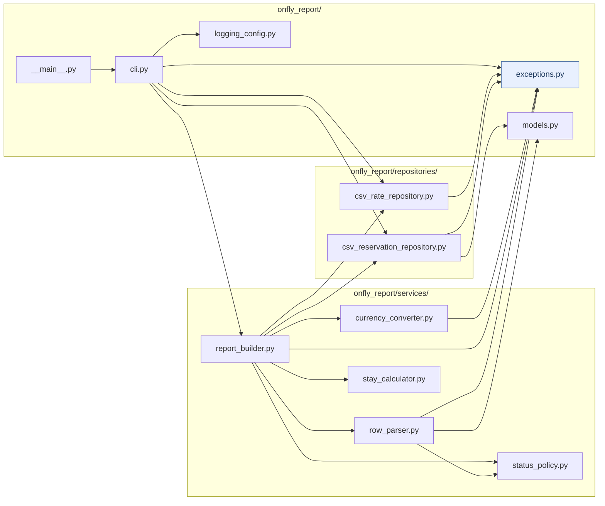

# Diagramas automáticos

Esta página é **gerada pelo código**. O script `docs/gerar_diagramas.py` lê a pasta `src/` e reescreve os trechos que ficam entre os marcadores `AUTO`. Não edite dentro dos marcadores, porque a próxima execução apaga a edição. O texto fora deles é livre.

Para atualizar:

```bash
python3 docs/gerar_diagramas.py
```

Para só conferir se a página está em dia (serve para o CI): `python3 docs/gerar_diagramas.py --check`. Ele sai com código 1 se a página estiver desatualizada.

O mapa mental, feito à mão, está em [`MAPA-MENTAL.md`](MAPA-MENTAL.md).

## Quem usa quem

Cada seta lê-se "usa". Por exemplo, `report_builder.py --> row_parser.py` quer dizer que o montador do relatório usa o leitor de linhas. Os arquivos em azul são usados por três ou mais outros.

<!-- AUTO:grafo:inicio -->

<!-- AUTO:grafo:fim -->

## Pastas e arquivos

A descrição de cada arquivo `.py` vem da primeira linha do texto que ele tem no topo (a docstring).

<!-- AUTO:arvore:inicio -->
```text
onfly-desafio/
├── .github/                                   # Verificação automática (CI)
│   └── workflows/
│       └── tests.yml
├── data/                                      # Arquivos CSV de entrada
│   ├── exemplo-validacao.csv
│   ├── reservas_hoteis.csv
│   └── taxas_cambio.csv
├── docs/                                      # Diagramas e mapa mental
│   ├── DIAGRAMAS.md
│   ├── gerar_diagramas.py                     # Gera os diagramas automáticos de docs/DIAGRAMAS.md
│   └── MAPA-MENTAL.md
├── entrega/                                   # Documentos da entrega
│   ├── uso-de-ia/
│   │   ├── declaracao.md
│   │   ├── sessao-01.md
│   │   └── sessao-02.md
│   ├── ANALISE.md
│   └── README-ENTREGA.md
├── output/                                    # Onde o relatório é gerado
├── src/                                       # Código do CLI
│   └── onfly_report/
│       ├── repositories/                      # Leitura dos CSV
│       │   ├── __init__.py
│       │   ├── csv_rate_repository.py         # Leitura da tabela de câmbio para BRL
│       │   └── csv_reservation_repository.py  # Leitura da exportação de reservas em CSV
│       ├── services/                          # Regras de negócio
│       │   ├── __init__.py
│       │   ├── currency_converter.py          # Conversão de valores para BRL
│       │   ├── report_builder.py              # Construção do relatório consolidado
│       │   ├── row_parser.py                  # Conversão de uma linha do CSV para o modelo de reserva
│       │   ├── status_policy.py               # Política de status das reservas
│       │   └── stay_calculator.py             # Cálculo de noites ocupadas
│       ├── __init__.py                        # CLI de consolidação de reservas de hotel da Onfly
│       ├── __main__.py
│       ├── cli.py                             # Interface de linha de comando do consolidador
│       ├── exceptions.py                      # Exceções de domínio do consolidador de reservas
│       ├── logging_config.py                  # Configuração de logging do CLI (sempre em stderr)
│       └── models.py                          # Modelos de dados do consolidador
├── tests/                                     # Testes
│   ├── cli_support.py                         # Apoio aos testes adicionais: executa o CLI sem exigir código de saída 0
│   ├── helpers.py                             # Utilitários dos testes fornecidos
│   ├── test_aggregation_extra.py              # Testes adicionais: lacunas de agregação não cobertas pelos testes fornecidos
│   ├── test_currency.py                       # Testes fornecidos: câmbio para BRL
│   ├── test_dataset_regression_extra.py       # Testes adicionais: regressão com os arquivos reais de data/
│   ├── test_exit_codes_extra.py               # Testes adicionais: códigos de saída e validação defensiva da entrada
│   ├── test_money_and_contract_extra.py       # Testes adicionais: exatidão do dinheiro e contrato do JSON
│   ├── test_nights.py                         # Testes fornecidos: noites de quarto na virada de mês
│   ├── test_regression_report.py              # Testes fornecidos: regressão ponta a ponta
│   ├── test_status_rules.py                   # Testes fornecidos: regras de status
│   └── test_top_hotels.py                     # Testes fornecidos: ranking de hotéis
├── .gitignore
├── pyproject.toml
├── README.md
├── requirements-dev.txt
└── requirements.txt
```
<!-- AUTO:arvore:fim -->

## O que cada arquivo define

<!-- AUTO:funcoes:inicio -->
| Arquivo | O que define | Resumo |
|-|-|-|
| `cli.py` | `build_parser()` | — |
| `cli.py` | `main()` | — |
| `exceptions.py` | `DomainError` (classe) | Erro base do domínio |
| `exceptions.py` | `InputFileError` (classe) | Arquivo de entrada ausente, ilegível ou fora do formato esperado |
| `logging_config.py` | `configure_logging()` | Configura o logger raiz para stderr, mantendo o stdout para o resumo |
| `models.py` | `RawRow` (classe) | Linha crua lida do CSV, com o número da linha física no arquivo |
| `models.py` | `Reservation` (classe) | Reserva já convertida para os tipos do domínio |
| `repositories/csv_rate_repository.py` | `CsvRateRepository` (classe) | Carrega moeda -> taxa para BRL a partir de um CSV |
| `repositories/csv_rate_repository.py` | `CsvRateRepository.read()` | — |
| `repositories/csv_reservation_repository.py` | `CsvReservationRepository` (classe) | Lê a exportação de reservas sem aplicar regra de negócio |
| `repositories/csv_reservation_repository.py` | `CsvReservationRepository.read()` | — |
| `services/currency_converter.py` | `convert_to_brl()` | Converte um valor na moeda informada para BRL: amount * rate_to_brl, em Decimal exato |
| `services/report_builder.py` | `format_money()` | Serializa dinheiro com duas casas, arredondamento half-up |
| `services/report_builder.py` | `ReportBuilder` (classe) | Orquestra leitura, conversão e agregação |
| `services/report_builder.py` | `ReportBuilder.build()` | — |
| `services/row_parser.py` | `RowParser` (classe) | Converte a linha crua em Reservation |
| `services/row_parser.py` | `RowParser.parse()` | — |
| `services/status_policy.py` | `is_known_status()` | Indica se o status faz parte do contrato do relatório |
| `services/status_policy.py` | `is_billable()` | Indica se a reserva entra nos totais financeiros e de noites (só CONFIRMED) |
| `services/stay_calculator.py` | `calculate_room_nights()` | Calcula noites de quarto: diferença de dias (não inclusiva) vezes quartos |
<!-- AUTO:funcoes:fim -->
