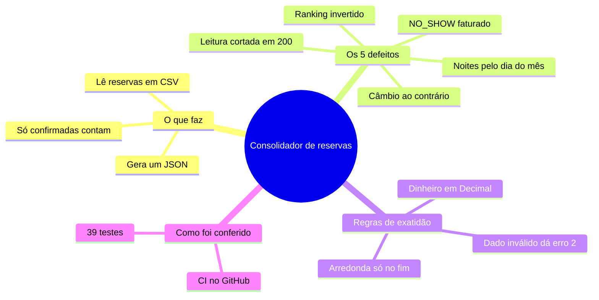

# Mapa mental do projeto

O projeto em uma olhada: o que faz, o que estava errado, que regras protegem os números e como foi conferido. Este mapa é escrito à mão e tem de propósito poucos itens e frases curtas. O passo a passo do relatório está no fluxo do [`README-ENTREGA.md`](../entrega/README-ENTREGA.md), e os diagramas que o código gera sozinho estão em [`DIAGRAMAS.md`](DIAGRAMAS.md).

Os números (39 testes) são os do [`README-ENTREGA.md`](../entrega/README-ENTREGA.md) em 18/11/2026.
