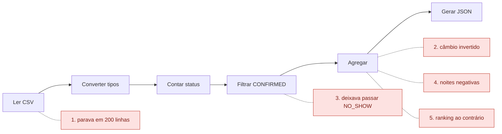

# Entrega — consolidador de reservas Onfly

O CLI gerava um relatório com números errados: lia só 200 das 300 reservas, contava noites negativas, convertia o câmbio ao contrário e faturava reservas `NO_SHOW`. Encontrei 5 defeitos, corrigi os 5 e agora os números batem com o cálculo independente e com a amostra do README.

| | Antes | Depois |
|-|-|-|
| Testes | 0 de 5 passando | 39 de 39 (5 fornecidos + 34 novos) |
| Reservas lidas | 200 | 300 |
| Noites | -1393 | 1347 |
| Total em BRL | 193218.53 | 396170.00 |
| Média por noite | — | 294.11 |

## Onde estava cada defeito

O caminho de cada reserva até o relatório, com os defeitos marcados na etapa em que aconteciam:



## Defeitos corrigidos

1. **Leitura cortada em 200 linhas** (`csv_reservation_repository.py`). Um `break` parava a leitura na linha 200 e descartava o resto sem avisar. Tirei o corte.
2. **Câmbio invertido** (`currency_converter.py`). O código dividia o valor pela taxa em vez de multiplicar, e ainda passava por `float`, que perde centavos. Agora é `valor * taxa`, só com `Decimal`.
3. **`NO_SHOW` faturado** (`status_policy.py`). A regra era "tudo menos `CANCELLED`", então `NO_SHOW` entrava nos totais. Agora só `CONFIRMED` conta.
4. **Noites pelo dia do mês** (`stay_calculator.py`). O código subtraía só o dia (`31 - 2`), e não a data inteira, o que dava noites negativas em toda virada de mês ou de ano. Agora é a diferença entre as datas vezes os quartos.
5. **Ranking ao contrário** (`report_builder.py`). Os hotéis saíam do menor valor para o maior. Agora saem do maior para o menor, com empate decidido por `hotel_id`.

Corrigi um defeito por vez e rodei os testes depois de cada um: 0 → 0 → 2 → 3 → 4 → 5 de 5. O primeiro não mudou nada porque nenhum teste fornecido usava mais de 200 linhas.

## Como investiguei

Fiz em duas sessões, separando o diagnóstico da correção:

- **Sessão 1, análise** (detalhes em [`ANALISE.md`](ANALISE.md)). Li as regras do README, rodei os testes e o CLI do jeito que estavam, chequei os CSVs (estão limpos, como o README diz) e calculei o resultado certo com um script à parte. A diferença entre esse cálculo e o que o CLI gerava apontou os 5 defeitos. Nenhum arquivo do projeto foi alterado nessa sessão.
- **Sessão 2, ação.** Corrigi os defeitos na ordem da análise, adicionei testes para o que os fornecidos não cobriam, gerei o relatório e conferi com a referência da sessão 1.

## O que mais mudou

- **Entrada inválida vira erro claro.** Moeda sem taxa, status desconhecido, `rooms` menor que 1 e check-out antes do check-in agora param o CLI com código de saída `2` e uma mensagem que diz a linha do problema. Antes, ou o CLI quebrava com erro genérico, ou gerava número errado sem avisar.
- **Os dados não foram tocados.** O CLI recusa dado ruim em vez de tentar consertá-lo, porque o README diz que os defeitos estão no código, não nos CSVs.
- **34 testes novos**, sem mexer nos fornecidos. Ficam em arquivos com `_extra` no nome, para não se confundirem com os originais:

  | Arquivo | O que cobre |
  |-|-|
  | `test_aggregation_extra.py` | Mais de 200 linhas, virada de ano, quartos, `by_month`, desempate do ranking, `--top` |
  | `test_money_and_contract_extra.py` | Arredondamento, média sem noites, formato do JSON |
  | `test_exit_codes_extra.py` | Códigos de saída 1 e 2 e cada tipo de linha inválida |
  | `test_dataset_regression_extra.py` | Regressão com os dois CSVs reais |
  | `cli_support.py` | Apoio: roda o CLI aceitando saída diferente de 0 |

  Os fornecidos (`test_currency.py`, `test_nights.py`, `test_regression_report.py`, `test_status_rules.py`, `test_top_hotels.py` e `helpers.py`) estão como vieram.

Um detalhe que parece erro, mas não é: somando os meses de `by_month` dá 396170.01, um centavo a mais que o total. Isso acontece porque cada valor é arredondado só na hora de escrever o JSON, como o README pede.

## Como validar

```bash
python3.11 -m venv .venv
source .venv/bin/activate
pip install -r requirements-dev.txt

pytest -q

PYTHONPATH=src python -m onfly_report \
  --input data/reservas_hoteis.csv \
  --rates data/taxas_cambio.csv \
  --output output/report.json
```

O CLI deve imprimir:

```
Reservas: 300 | Confirmadas: 235 | Noites: 1347 | Total BRL: 396170.00
```

O `output/report.json` não vai para o repositório, porque `output/` está no `.gitignore`. O comando acima gera o arquivo de novo.

## Resultado do pytest

```
$ pytest -q
.......................................                                  [100%]
39 passed
```

## Uso de IA

Usei o Claude Code nas duas sessões. As exportações e a declaração estão em [`uso-de-ia/`](uso-de-ia/).

## Checklist

- [x] CLI roda com Python 3.11 (testado com 3.11.16)
- [x] Gera `output/report.json` sem erro ([Como validar](#como-validar))
- [x] Relatório segue o contrato (`test_report_shape_matches_contract`)
- [x] `pytest -q` passa com os testes fornecidos (5 de 5, sem alteração; 39 no total)
- [x] `README-ENTREGA.md` preenchido (este arquivo)
- [x] Sessões + declaração ([`uso-de-ia/`](uso-de-ia/))
- [x] Repositório público no GitHub
