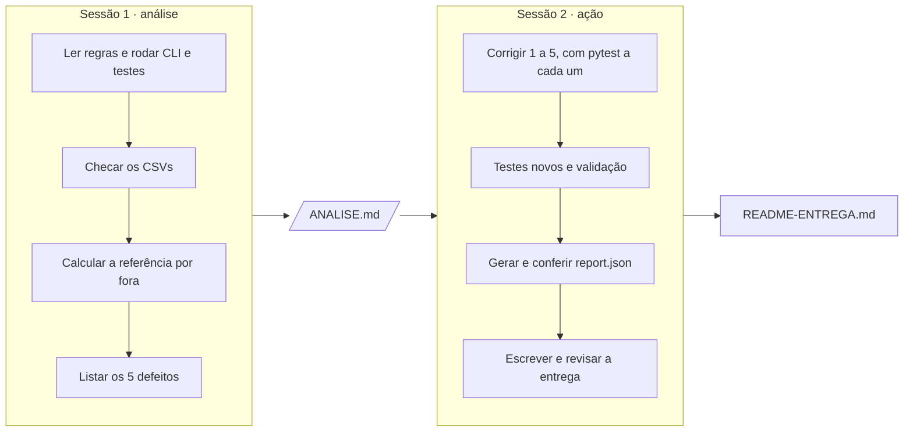

# Declaração de uso de IA

- **Ferramenta:** Claude Code (CLI), plano Claude Pro: v2.1.323 na sessão 1 e v2.1.325 na sessão 2
- **Modelo:** Claude Opus 5.5 (`claude-opus-5-5`)

## Como o trabalho foi dividido

Fiz o trabalho em duas sessões: uma só para diagnosticar e outra para corrigir. O `ANALISE.md` é a ponte entre elas. A sessão 2 começou do zero, sem a conversa da primeira, e partiu só desse arquivo.

As exportações são o arquivo gerado pelo `/export`, sem edição. Os números de linha abrem o trecho da conversa direto no GitHub.

## Sessão 1 — análise ([`sessao-01.md`](sessao-01.md))

Nenhum arquivo do projeto foi alterado nesta sessão.

| Linha | Meu pedido | Resultado |
|-|-|-|
| [6](sessao-01.md?plain=1#L6) | Analisar a pasta do projeto | Visão geral, estado atual e os 5 defeitos |
| [84](sessao-01.md?plain=1#L84) | Separar análise e ação em duas sessões? | Plano das duas sessões, com o export de cada uma |
| [165](sessao-01.md?plain=1#L165) | Analisar pasta por pasta; tratar os dados do CSV ou não? | Análise detalhada; decisão de não alterar os dados |
| [332](sessao-01.md?plain=1#L332) | Fechar a análise | `ANALISE.md` escrito |

## Sessão 2 — ação ([`sessao-02.md`](sessao-02.md))

| Meu pedido | Resultado |
|-|-|
| Corrigir os defeitos 1 a 5 um por vez, com `pytest` depois de cada um | 0 → 0 → 2 → 3 → 4 → 5 de 5 testes |
| Testes das lacunas, validação defensiva, `report.json` conferido | 34 testes novos; números iguais à referência |
| Revisar a entrega: formato do README, texto mais curto e acessível, diagrama | `README-ENTREGA.md` reescrito e pasta `uso-de-ia/` organizada |
| Conferir o checklist do README e a apresentação dos arquivos | Pendências levantadas; declaração com diagrama e índice das sessões |

## O que eu fiz

- Decidi separar diagnóstico e correção em duas sessões, para que a análise ficasse registrada antes de qualquer mudança no código.
- Conduzi a análise por partes (`data/`, `repositories/`, `services/`, `tests/`) e decidi não alterar os CSVs.
- Defini a ordem da correção: um defeito por vez, testando a cada passo.
- Revisei a entrega e pedi mudanças: estrutura no formato do README, texto mais curto, diagrama e conferência do checklist.

## O que a IA fez

- Leu código, testes e dados, rodou o CLI e calculou a referência com um script à parte.
- Apontou os defeitos com arquivo e linha, além das fragilidades e das lacunas de teste.
- Escreveu as correções, a validação de entrada e os testes novos.
- Gerou e conferiu o `report.json` e redigiu o `ANALISE.md`, o `README-ENTREGA.md` e esta declaração.
